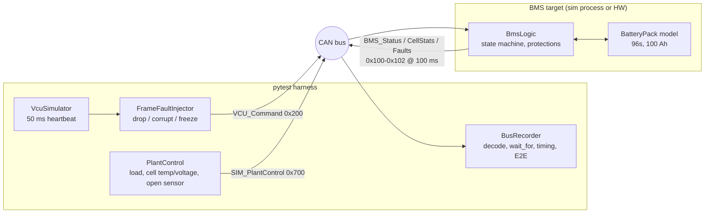

# bms-can-testbench


A simulated electric-vehicle **Battery Management System (BMS)** ECU on a CAN
bus, and a **black-box pytest framework** that verifies it against written
requirements, with fault injection, timing checks and requirement traceability.

The tests talk to the BMS only over CAN. The same suite therefore runs against:

1. an in-process simulator on a python-can virtual bus (fast, no setup),
2. the simulator as a separate process on Linux SocketCAN (`vcan0`), and
3. *(planned)* real BMS firmware on a microcontroller in a hardware-in-the-loop rig.

## What it tests

| Area | Examples |
|---|---|
| Cyclic timing | 100 ms period ±10 %, no gaps over 150 ms |
| E2E protection | Rolling counter and checksum on every frame |
| State machine | INIT → STANDBY → DRIVE/CHARGE, no direct DRIVE↔CHARGE switch, contactors closed only when allowed |
| Cell protection | Overtemperature, under/overvoltage and overcurrent, with exact threshold and debounce checks |
| Sensor plausibility | An open thermistor raises `SensorFault`, not a false `OverTemp`, and does not mask a real one |
| Communication faults | Dropped, corrupted and frozen-counter VCU heartbeats; timeout detection and short-gap tolerance |
| Fault handling | Latching, and recovery that is refused while the condition is still present |

Every test is tagged with a requirement ID from the
[test plan](docs/TEST_PLAN.md). Each run prints a coverage table:

```
============================= requirement coverage =============================
BMS-001    PASS     3 test(s)
BMS-002    PASS     3 test(s)
...
BMS-013    PASS     3 test(s)
83 passed in 27.80s
```

## Architecture



## Quick start

Requires Python 3.10+.

```bash
python -m venv .venv && source .venv/bin/activate
pip install -e ".[dev]"

pytest                                   # unit + integration, ~30 s
pytest tests/unit                        # deterministic logic tests, <1 s
pytest --html=reports/report.html --self-contained-html --traceability reports/traceability
```

### Run against Linux SocketCAN

```bash
sudo modprobe vcan
sudo ip link add dev vcan0 type vcan && sudo ip link set up vcan0

canbench-sim --interface socketcan --channel vcan0 &      # the "ECU"
candump -td vcan0                                         # watch traffic (can-utils)

CANBENCH_INTERFACE=socketcan CANBENCH_CHANNEL=vcan0 CANBENCH_EXTERNAL=1 \
    pytest tests/integration
```

`canbench-sim --with-vcu drive` also simulates the VCU, so you can watch the
BMS close its contactors in `candump` or decode the trace with
`cantools monitor`.

### Write a test

```python
import time
from canbench import BmsState, RequestedState


def test_overtemp_while_driving_opens_contactors(bench):
    bench.request(RequestedState.DRIVE)
    since = time.time()
    bench.plant.set_cell_temp(42, 68.0)

    bench.wait_for_fault("OverTemp", timeout=0.5, since=since)
    status = bench.wait_for_state(BmsState.FAULT, since=since)
    assert status["ContactorsClosed"] == 0
```

## Project layout

```
src/canbench/
  dbc/bms.dbc     CAN database (messages, signals, scaling, enums)
  protocol.py     encode/decode, checksum, rolling counter
  pack.py         battery electro-thermal model with sensor fault injection
  bms.py          BMS logic (pure, clock-driven) + real-time CAN node
  vcu.py          VCU heartbeat simulator
  faults.py       frame-level fault injector
  plant.py        SIM_PlantControl client
  monitor.py      bus recorder, period statistics, E2E checks
  harness.py      Testbench: wires everything together for tests
  cli.py          canbench-sim entry point
tests/unit/         deterministic tests with a simulated clock
tests/integration/  black-box tests over CAN
docs/TEST_PLAN.md   requirements, test levels, fault matrix, exit criteria
```

## CI

GitHub Actions runs:

* ruff lint and format checks,
* the full suite on Python 3.10–3.12 over the virtual bus,
* the integration suite on a real `vcan0` against `canbench-sim` running as a
  separate process, with a `candump` trace archived.

JUnit XML, HTML reports and the traceability matrix are uploaded as artifacts,
and the matrix appears in the job summary.

## Roadmap

- [ ] Hardware-in-the-loop: run the BMS on an ESP32/STM32 with a CAN
      transceiver, and drive the same suite through a USB-CAN adapter.
- [ ] Cell balancing and a SOC estimator with accuracy tests.
- [ ] UDS diagnostics (read DTCs, clear DTCs) over ISO-TP.

## License

MIT
